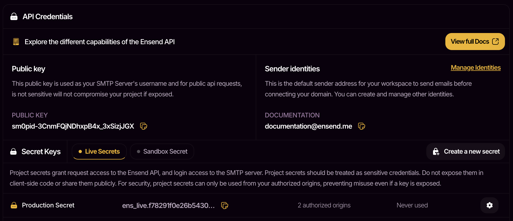
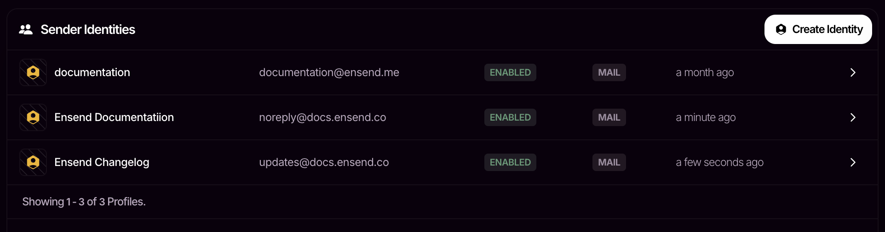

## Overview

Ensend verifies that requests are authorized before they are accepted and processed. This requirement is met by providing your project secret as a bearer token in the authorization header of your request.

In this guide, you'll learn how to obtain a project secret to authenticate your requests to the Ensend API.

<Info>
  An Ensend account is needed to follow along. If you don't already have one, [create your account](https://ensend.co/signin) and come back to this guide.
</Info>

## Project Secrets

Your project secret keys are essentially your API keys. They are sent as `bearer tokens` in your request header. When using the SDKs, you are to provide your secret when creating your Ensend client.

<Warning>
  Project secrets should be treated as sensitive credentials. Do not expose them in client-side code or share them publicly.
</Warning>

<Frame>
  
</Frame>

<Info>
  Navigate to `Workspace > Project > Credentials` to view your project secrets.
</Info>

<AccordionGroup>
  <Accordion title="Live Secrets vs Sandbox Secrets">
    |  | Live Secrets | Sandbox Secrets |
    | --- | --- | --- |
    | Environment | Use when sending from your production environments | Use when sending from non-production environments |
    | Delivery | Messages get delivered to recipients | Messages are not delivered, but can be viewed on ensend |
    | Pricing | Standard rates apply | Free to use |

    <Info>
      Navigate to `Workspace > Project > Sandbox Messages` to view your sandbox messages.
    </Info>
  </Accordion>

  <Accordion title="What are Authorized Origins?">
    Each project secret has a set of authorized origins you can modify. Origins are typically domains that your request will be sent from. Requests made from unlisted origins will be denied. This helps secure your project secrets from misuse in the case of an accidental exposure.

    Example values are: `localhost`, `app-name.netlify.app`, `website.com`.

    <Info>
      Manage your list of authorized origins by clicking on the  <Icon icon="gear" />  icon of your project secret.
    </Info>
  </Accordion>
</AccordionGroup>

## Sender Identities

Sender identities are used as sender addresses when sending emails. Every workspace has a default sender identity ending with `@ensend.me` that is shared across all projects in the workspace. Even when you don't have a domain, you can still send messages on Ensend.

<Frame>
  
</Frame>

<Info>
  Navigate to `Workspace > Project > Identities` to view your sender identities. To use custom identities, you'll need to [connect a domain to your workspace](https://docs.ensend.co/installation).
</Info>

## Public Key

Your public key is  your username when connecting with our SMTP server to send messages over SMTP. It is also used as an API key for a limited set of API actions. Unlike project secrets, it is safe for use on the client-side.

## Next Steps

Now that you have your api credentials, follow the [quickstart guide](/quickstart) to send your first message.