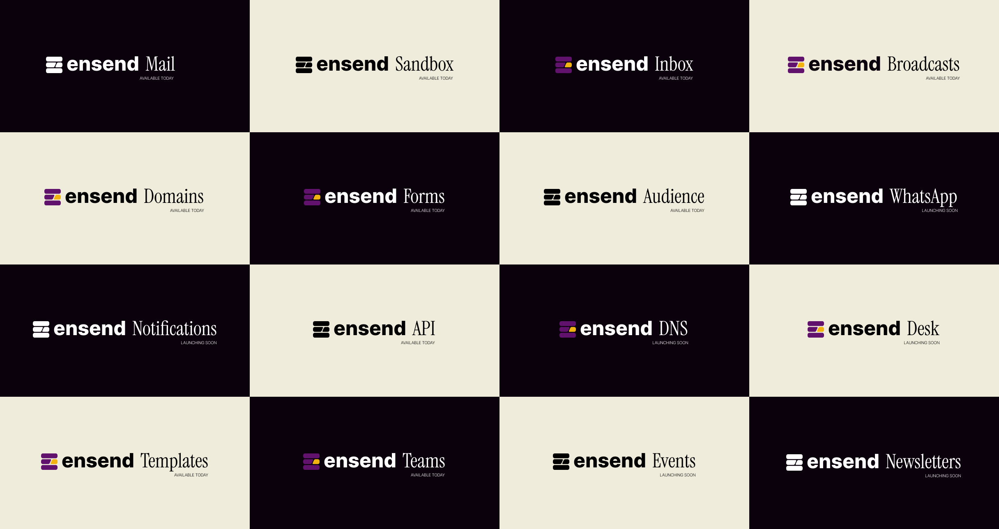

## Overview

Ensend provides a suite of APIs to send notification and broadcast messages across Email, SMS(soon), WhatsApp(soon) and Push Notification(soon).

<Frame>
  
</Frame>

## What's Inside?

- [ The Send API](/credentials)  <Icon icon="arrow-right" color="#F3B111" size={14} />\
  A collection of endpoints to programmatically send email, sms, whatsapp, push notifications and broadcasts.
- [**The Project API**](/credentials) <Icon icon="arrow-right" color="#F3B111" size={14} />\
  A collection of endpoints to interface with your projects and create custom workflows in your application.

Our goal with this documentation is to get you started with the API and help you send exciting messages to your customers from your applications.